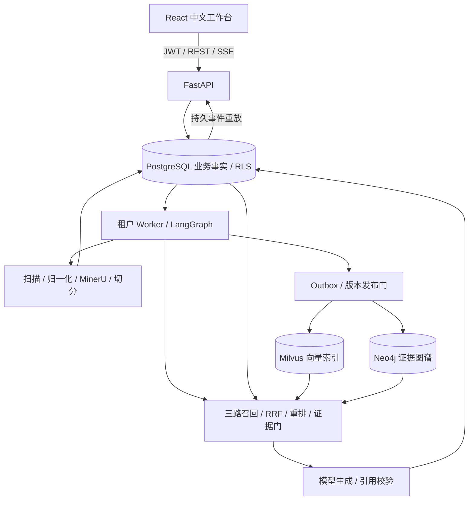

# 掌柜智库 · 企业知识库 RAG 系统

> 面向企业文档的检索增强问答应用：React 工作台 + FastAPI + LangGraph，以 PostgreSQL 保存业务事实，通过 Milvus 向量、jieba / BM25 关键词和 Neo4j 图谱三路召回，提供文档导入、证据引用、任务恢复和多租户权限隔离。

[快速开始](QUICKSTART.md) · [项目解析](PROJECT_SUMMARY.md) · [系统架构](docs/architecture.md) · [问答链路](docs/query_pipeline.md) · [验证记录](docs/verification.md) · [发布说明](docs/publication.md)

本项目位于 [TGQ 仓库](https://github.com/tgq18715195466/TGQ) 的 `RAG_AGENT/` 目录，与仓库根目录的企业 ERP 独立运行。功能说明依据当前源码；真实服务历史验证、此次回归和未完成的业务验收分别记录。

---

## ✨ 核心特性

### 🎯 三路召回与证据筛选

- **向量检索**：OpenAI-compatible Embedding 服务生成向量，Milvus 按模型和维度隔离 collection。
- **关键词检索**：jieba 中文分词 + Okapi BM25；先过滤授权且当前有效的片段，再计算词频和排序。
- **图谱检索**：Neo4j 实体与关系查询，最多两跳扩展，关系保留来源片段证据。
- **融合与重排**：RRF 融合三路候选，兼容 TEI 的 reranker 重排，再按问题类型选择上下文。
- **证据门**：检查重排分数、问题数字和编号覆盖；资料不足时明确提示，避免生成无依据的确定结论。

源码：[query.py](app/query.py)、[keyword.py](app/keyword.py)、[retrieval.py](app/retrieval.py)。

### 📚 文档导入与版本发布

- 接收 PDF、UTF-8 文本、图片及 DOCX / PPTX / XLSX，校验文件签名、大小、页数和容器结构。
- 扫描 → PDF 归一化 → MinerU → 质量检查 → 结构切分，保留页码、章节、表格和公式信息。
- 默认限制 50 MiB / 500 页；图片另有像素和大小限制，Office 转换需要 LibreOffice。
- PostgreSQL 保存原文件、规范化 PDF、解析结构、资产和完整片段。
- 质量通过且向量、图谱同步收据完成后才发布新版本；新版本处理中旧版本仍可查询。

源码：[ingestion/](app/ingestion/)、[ingest_runner.py](app/ingest_runner.py)、[sync.py](app/sync.py)。

### 🔐 多租户与可追踪引用

- 用户名密码登录、加盐密码哈希、短期 JWT；浏览器令牌保存在当前标签页的 sessionStorage。
- PostgreSQL 强制 RLS、知识库成员关系和文档 ACL 共同约束访问；检索及最终回表再次检查权限。
- 引用包含文档、版本、页码、章节和原文片段；下载与历史会话同样执行权限检查。
- 事实问答采用逐字摘录校验；总结 / 对比允许改写并检查数字是否出现在引用片段中，后者不等同于完整语义事实校验。

### 🔄 持久任务、恢复与 SSE

- LangGraph 编排导入和问答，PostgreSQL 保存任务阶段、checkpoint 与事件。
- Worker 按租户运行，支持重试、阶段恢复、取消和索引一致性巡检。
- Outbox 连接业务事务和外部索引；必要同步未完成时不发布文档。
- SSE 使用持久递增序号，支持 `Last-Event-ID` 重放；答案校验后分段发送，并非模型 token 直接透传。
- Redis 仅用于可选限流；业务任务和会话持久化不依赖 Redis 队列。

### 💻 中文工作台与评测工具

- React 页面包含总览、知识库、文档、问答、历史引用、评测和系统状态。
- 提供 Recall / MRR / 引用指标计算及可选 RAGAS 接入。
- 小型 fixture 用于验证指标计算逻辑，不代表真实业务质量和性能达标。

---

## 🛠️ 技术栈

- **前端**：React 19、TypeScript、Vite、React Router；Vitest + Testing Library。
- **API**：Python 3.12 / 3.13、FastAPI、Uvicorn、Pydantic Settings。
- **工作流**：LangGraph、PostgreSQL checkpointer、独立 Worker。
- **事实存储**：PostgreSQL、SQLAlchemy、Alembic、强制 RLS。
- **检索**：Milvus、Neo4j、jieba / BM25、RRF、TEI reranker。
- **解析**：MinerU 适配器、pypdf、Pillow、LibreOffice；HTTP 扫描适配及 ClamAV 桥接。
- **模型**：兼容 `/embeddings`、`/chat/completions` 的服务；示例使用 BGE-M3 和 DeepSeek 配置。
- **部署与验证**：Docker Compose、pytest、Ruff、GitHub Actions。

## 🏗️ 系统架构



## 🚀 快速开始

需要 Python 3.12 / 3.13、Node.js 24 和独立 PostgreSQL 应用数据库。完整文档处理还需要 MinerU、Milvus、Neo4j、Embedding、Reranker、模型及扫描服务。

```powershell
git clone https://github.com/tgq18715195466/TGQ.git
cd TGQ/RAG_AGENT
python -m venv .venv
.\.venv\Scripts\python.exe -m pip install -r requirements.lock
.\.venv\Scripts\python.exe -m pip install --no-deps -e .
npm ci --prefix web
npm run build --prefix web
```

按 [QUICKSTART.md](QUICKSTART.md) 创建独立数据库、配置 `.env`、迁移和初始化账号，再启动 API 与 Worker。已有 `.env` 的环境不要覆盖配置。

```powershell
.\.venv\Scripts\python.exe -m uvicorn app.api:app --host 127.0.0.1 --port 8000
# 第二个终端，在项目目录运行：
$demo = Get-Content .runtime/demo.json | ConvertFrom-Json
.\.venv\Scripts\python.exe -m app.worker --tenant $demo.tenant_id
```

- 工作台：<http://127.0.0.1:8000/>
- OpenAPI：<http://127.0.0.1:8000/docs>
- API 存活检查：<http://127.0.0.1:8000/health/live>
- 数据库就绪检查：<http://127.0.0.1:8000/health/ready>（仅检查 PostgreSQL）

本机已有模型的启动方式见 [依赖部署记录](docs/local_dependencies.md)。`compose.dependencies.yaml` 挂载本地模型权重，克隆仓库不会自动具备这些权重。

## 📁 项目结构

```text
RAG_AGENT/
├── README.md                 # 项目入口与能力说明
├── QUICKSTART.md             # 新环境安装与本机启动
├── PROJECT_SUMMARY.md        # 项目解析与工程决策
├── app/
│   ├── api.py                # 认证、知识库、文档、问答、评测
│   ├── models.py             # 业务数据模型
│   ├── repository.py         # 授权查询、引用与版本发布
│   ├── ingestion/            # 校验、归一化、MinerU、结构切分
│   ├── ingest_runner.py      # 导入阶段执行与持久化
│   ├── query.py              # LangGraph 混合检索问答
│   ├── keyword.py            # jieba + BM25
│   ├── retrieval.py          # 融合、上下文、证据校验
│   ├── adapters/             # 模型、Milvus、Neo4j 适配器
│   ├── worker.py             # 持久任务消费和恢复
│   └── sync.py               # Outbox、删除补偿、巡检
├── web/                      # React、前端测试与构建配置
├── alembic/                  # 迁移、RLS、初始化 schema
├── scripts/                  # 初始化、启动、管理与检查
├── tests/                    # 单元、数据库、可选外部测试
├── eval/                     # 评测入口和示例数据
├── deploy/                   # 数据库、索引和扫描配置
├── docs/                     # 架构、模型、流程与验证记录
├── compose.yaml              # 应用与基础依赖编排
├── compose.dependencies.yaml # 本机模型依赖编排
├── Dockerfile
├── .env.example
├── pyproject.toml
└── requirements.lock
```

## 🔎 一次问答如何完成

1. API 校验身份与知识库范围，保存会话消息和 QueryRun。
2. Worker 分类问题并规范化查询，向量、关键词和图谱三路并行召回。
3. RRF 融合后回 PostgreSQL 校验权限及当前版本，再调用 reranker。
4. 按问题类型选择上下文：总结优先不同章节，对比优先不同文档。
5. 证据门通过后调用模型，校验引用、摘录或总结中的数字。
6. 最终提交前锁定文档和 QueryRun，再检查权限与取消状态。
7. 答案、引用和 SSE 事件在同一事务提交，浏览器读取已提交事件。

默认向量 / 关键词 / 图谱召回为 40 / 30 / 30，RRF `k=60`，最多重排 50 条，常规上下文 10 条、每文档最多 4 条。详见 [config.py](app/config.py)。

## 🔌 API 接口速览

- **登录**：`POST /api/v1/auth/login`、`GET /api/v1/me`。
- **知识库**：`GET / POST /api/v1/knowledge-bases`。
- **文档**：`GET / POST /api/v1/kbs/{kb_id}/documents`；详情、内容、下载及删除位于 `/api/v1/documents/{document_id}` 及其子路径。
- **任务**：`GET /api/v1/jobs/{job_id}`、`POST /api/v1/jobs/{job_id}/cancel`、`POST /api/v1/document-versions/{version_id}/retry`。
- **问答**：`GET / POST /api/v1/chat/sessions`、`POST /api/v1/chat/runs`、`GET /api/v1/chat/runs/{run_id}/events`。
- **反馈与取消**：`POST /api/v1/chat/runs/{run_id}/feedback`、`POST /api/v1/chat/runs/{run_id}/cancel`。
- **评测**：`GET /api/v1/eval-datasets`、`GET / POST /api/v1/eval-runs`、`GET /api/v1/eval-runs/{run_id}`。

请求体及鉴权要求以 `/docs` 为准。上传、重试、删除、取消和反馈等变更需要 `Idempotency-Key`。

## ⚙️ 配置说明

复制 `.env.example` 后填写实际配置；真实凭据不进入版本库。

- **数据库**：`POSTGRES_DSN`、`POSTGRES_EXPECTED_DATABASE`、`POSTGRES_EXPECTED_USER`；应用角色不得为超级用户或绕过 RLS。
- **认证**：`JWT_SECRET` 至少 32 字节；本地账号初始化需 `ENVIRONMENT=development`。
- **模型**：`EMBEDDING_*`、`RERANKER_*`、`LLM_*`；模型名称以实际服务支持为准。
- **索引与解析**：`MILVUS_*`、`NEO4J_*`、`MINERU_BASE_URL`。
- **扫描**：`SCANNER_URL`；缺少扫描器默认阻止文件处理。开发旁路仅适用于显式开启的本地可信文件测试。
- **搜索**：`WEB_SEARCH_ENABLED` 与请求参数双开关；外部结果尚未接入可验证答案。

## ✅ 验证与当前边界

```powershell
.\.venv\Scripts\python.exe scripts/run_local_tests.py -q
npm test --prefix web
npm run build --prefix web
.\.venv\Scripts\python.exe -m ruff check app scripts eval tests --select F
.\.venv\Scripts\python.exe scripts/check_forbidden.py
```

历史记录包含真实 PostgreSQL 回归和 2026-10-11 的 Milvus / Neo4j / MinerU 与模型接口验证。此次复验范围见 [发布说明](docs/publication.md)，历史结果不代表当前所有服务仍在线。

- 图谱采用明确标签和关系模式的确定性抽取，不是通用自然语言关系抽取。
- 总结校验约束引用和数字，不能证明所有改写内容均被来源语义支持。
- BM25 每次加载授权语料并分词，尚未证明百万片段规模性能。
- 生产 SSO、在线模型无缝迁移、外部搜索证据闭环和完整生产运维验收尚未完成。
- 不提供未经测量的 OCR 准确率、真实 RAGAS 指标、并发能力或恢复时间承诺。

## 📖 文档与参考

- [数据模型](docs/data_model.md) · [导入链路](docs/ingestion_pipeline.md) · [问答链路](docs/query_pipeline.md)
- [运维与恢复](docs/operations.md) · [迁移指南](docs/migration_guide.md) · [评测说明](docs/evaluation.md)
- [实施状态](docs/implementation_status.md) · [验证记录](docs/verification.md)

章节组织参考 [FinanceWiki Agent](https://github.com/harrycjs/financewiki-agent)。技术与功能说明来自掌柜智库自身代码，不代表包含参考项目的记忆或技能系统。
