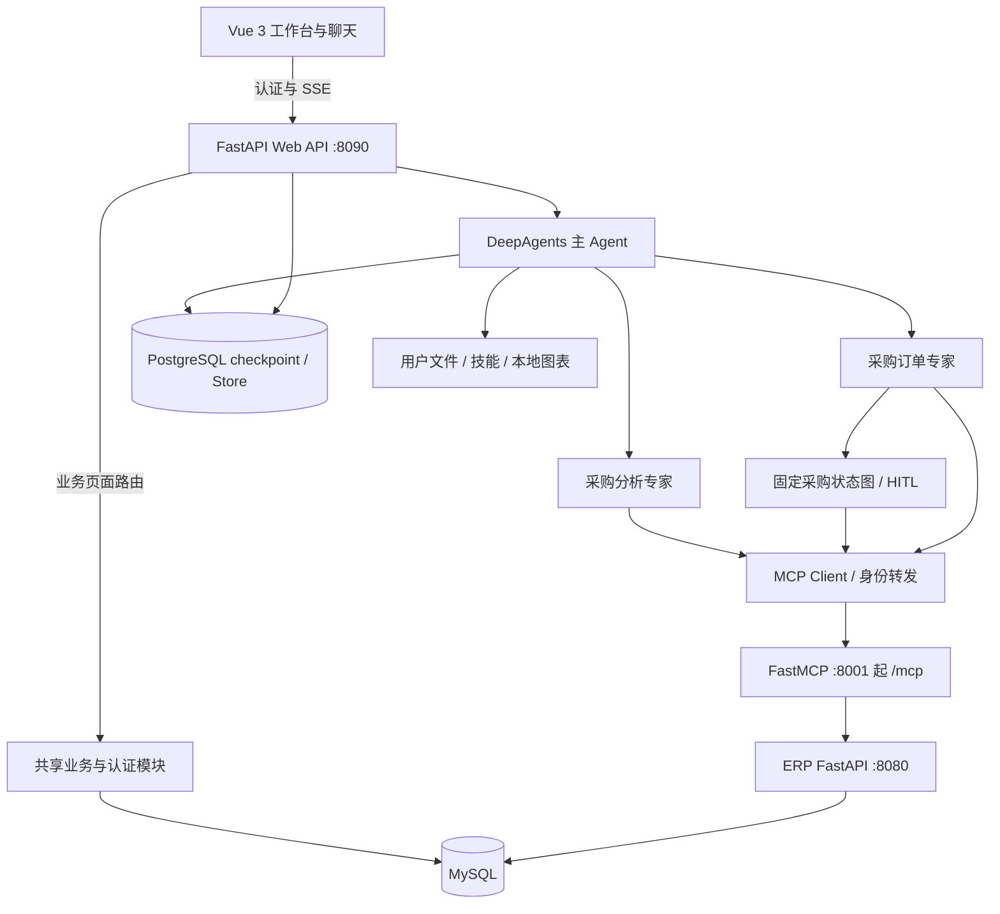
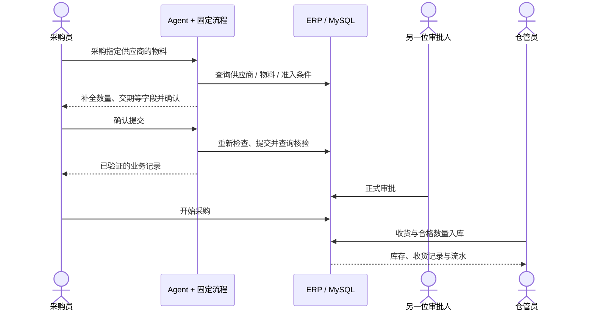

# 企业ERP  · 风驰采购与仓储智能助手

> 本仓库包含两个独立项目：根目录为企业 ERP；[掌柜智库 · RAG 系统](RAG_AGENT/README.md) 位于 `RAG_AGENT/`。
>
> RAG：[项目解析](RAG_AGENT/PROJECT_SUMMARY.md) · [快速开始](RAG_AGENT/QUICKSTART.md) · [发布与验证](RAG_AGENT/docs/publication.md)


> 面向摩托车零配件业务的 ERP Agent 应用：以 Vue 3 工作台连接 FastAPI、LangGraph / DeepAgents 与 MCP，把查询分析、采购申请、订单、审批、收货和库存流水连接为可追踪的业务流程。
本仓库同时提供业务源码、部署配置、测试与中文解析；功能描述以当前源码为依据。

[快速开始](QUICKSTART.md) · [项目总结](PROJECT_SUMMARY.md) · [架构详解](docs/architecture.md) · [业务需求与边界](docs/PRD.md) · [测试与验证](docs/testing.md) · [后续计划](docs/project-plan.md)

---

## 核心特性

### 多 Agent 协作与确定性采购流程

- 主 Agent 负责意图理解、任务委派、答案组织、记忆和技能管理。
- `procurement-analyst` 负责供应商、物料、库存等查询与分析。
- `procurement-order` 负责采购申请、订单、库存调整及主数据操作入口；两个业务专家由 YAML 声明工具集和提示词。
- 创建订单 / 采购申请进入固定 LangGraph 子流程：识别需求 → 查询主数据 → 校验准入 → 补全信息 → 用户确认 → 再检查 → 提交 → 查询验证 → 回复。
- 对物料名称、编码、内部 ID 做确定性解析；有歧义就补充信息，写入后再核对业务记录。恢复阶段区分“查询重试”和“已尝试写入后的核验”。

### MCP 工具层

自建 FastMCP Server 通过 Streamable HTTP 暴露 **14 个业务工具**，再经 `httpx` 调用仓库内的 ERP FastAPI 后端：

| 领域 | 工具 |
| --- | --- |
| 供应商 | `supplier_query` |
| 物料 | `part_query`、`part_search`、`part_by_supplier` |
| 库存 | `inventory_warning`、`inventory_adjust` |
| 订单 | `order_create`、`order_update`、`order_search_details` |
| 运营 | `daily_receipts`、`replenishment_suggestions`、`master_change_request`、`purchase_request_create` |
| 写入核验 | `procurement_verification` |

工具可见性按 Agent 职责控制；登录身份经请求上下文转发至业务后端，最终权限仍由服务器校验。源码入口：[MCP 注册](src/mcp_server/server_main.py)、[HTTP 桥接](src/mcp_server/http_base.py)。

### 人工确认、正式审批与库存闭环

- 聊天支持缺失信息补充、执行前确认、拒绝与恢复；刷新后可读取未完成的中断。
- **Agent 执行确认与正式业务审批是两个阶段**：确认提交不代表订单已审批或已收货。
- 采购订单、采购申请和新增主数据申请支持审批，禁止创建人自审。
- 订单审批、开始采购、收货、库存调整分别承担不同业务动作；库存更新伴随流水、幂等键与事务校验。
- 采购员、仓管员、审批人和管理员各有权限；审批人 / 管理员编辑现有主数据可直接生效并留审计记录。

### 登录、角色权限与用户隔离

- 首次访问创建管理员，无默认账号密码；之后由管理员维护账号。
- 服务器会话认证，浏览器使用 HttpOnly Cookie；MCP 内部调用转发 Bearer 会话令牌。
- 密码采用带随机盐的 PBKDF2-SHA256；会话有效期 8 小时，退出、停用或改密可撤销会话。
- 操作人来自服务端登录身份；聊天线程、偏好、文件和附件按用户作用域隔离。
- 当前 Agent 使用受目录约束的文件后端，**不向模型暴露任意 shell / execute 能力**。

详见 [登录与角色权限](docs/auth-rbac.md)。

### 记忆、技能与持久化

- `AGENTS.md` 提供通用指引；checkpoint 保存对话状态、业务子流程和中断。
- 用户偏好与技能通过 StoreBackend 路由保存；PostgreSQL 同时承载 checkpoint、Store 和展示历史。
- 技能按主 Agent / 分析专家 / 订单专家的目录组织，配合恢复与同步中间件。
- 主模型与摘要模型分别配置，默认通过 `ChatOpenAI` 接入 DeepSeek 兼容接口；并实现自动多供应商故障切换。
- PostgreSQL 不可用时有内存 checkpoint / Store 降级，但网页最终答案还依赖展示历史落盘；完整体验应配置 PostgreSQL，并设置 `POSTGRES_REQUIRED=true`。

### 流式交互与业务结果展示

Vue 前端用 `fetch + ReadableStream` 消费 SSE，展示答案、工具状态、补全表单和确认面板。对外答案、工具明细和内部模型 / 记忆处理分开组织，业务结果使用结构化数据呈现；支持本地 SVG 图表、受用户权限约束的附件，以及可选网络搜索和外部图表 MCP。

---

## 技术栈

| 层 | 技术与职责 |
| --- | --- |
| 前端 | Vue 3、Vite、markdown-it、highlight.js；采购 / 仓储工作台与流式聊天 |
| Web API | FastAPI、Uvicorn；认证、聊天、历史、附件与业务页面接口 |
| Agent | DeepAgents、LangGraph、LangChain；任务委派、中间件、固定采购状态图 |
| 工具协议 | FastMCP、langchain-mcp-adapters、httpx |
| 业务后端 | Python FastAPI + PyMySQL；业务规则与事务 |
| 业务存储 | MySQL；主数据、单据、库存、账号与审计 |
| Agent 存储 | PostgreSQL、AsyncPostgresSaver、AsyncPostgresStore |
| 部署 | Docker Compose 六服务、Nginx SSE 代理；Windows 本地启动器 |
| 验证 | pytest、Node test runner、Vite build；可选真实数据库测试与 Agent 黑盒评测 |

运行环境推荐 Python 3.12（本次实际 3.12.14；项目声明最低 3.10）、Node.js 22+、MySQL 8、PostgreSQL 16。Python 依赖仍采用版本区间。

## 系统架构



Web API 复用业务模块；MCP 路径调用独立的 ERP 后端，两者都使用相同的数据库和认证规则。[完整数据流与源码索引](docs/architecture.md)

## 快速开始

完整步骤见 [QUICKSTART.md](QUICKSTART.md)，以下命令在仓库根目录执行。

```powershell
python -m venv .venv
.\.venv\Scripts\python.exe -m pip install -r requirements.txt
npm.cmd --prefix frontend ci
Copy-Item .env.example .env
# 填写模型、MySQL、PostgreSQL 配置，并按快速指南初始化空数据库
.\.venv\Scripts\python.exe run_local.py


## 项目结构

```text
ERP-OpenClaw/
├── README.md                     # GitHub 项目入口
├── PROJECT_SUMMARY.md            # 项目总结与工程决策
├── QUICKSTART.md                 # 安装、数据库与启动
├── backend/                     # 业务 API、认证、库存与采购事务
├── src/
│   ├── agent/
│   │   ├── main_agent.py         # Agent 装配与工具职责
│   │   ├── procurement_workflow.py # 固定采购状态图
│   │   ├── postgres_persistence.py # checkpoint / Store / 展示历史
│   │   ├── subagents/configs/    # 两个 YAML 业务专家
│   │   ├── middlewares/          # 权限、记忆、技能、结果处理
│   │   └── tools/                # 流程、图表、搜索与身份桥接
│   ├── api_view/                # SSE、恢复、会话、附件与健康检查
│   ├── mcp_server/              # 14 个 ERP 工具及 HTTP 桥接
│   └── skills/                  # main / procurement / order 技能
├── frontend/                    # Vue 工作台、前端测试与 Nginx
├── deploy/                      # 空 MySQL schema、容器入口与探针
├── tests/                       # unit / integration / e2e
├── evals/                       # Agent SSE 黑盒评测框架与基线数据集
├── docs/                        # 架构、需求、角色、验证与规划
├── docker-compose.yml           # 六服务编排
├── requirements.txt
└── run_local.py                 # 本地启动器
```

## 典型业务流程



## 测试与当前边界

在原始项目现有环境执行：Python **734 passed **；前端 **153 passed**；Vite 构建成功。构建有大包提示，Python 有 7 条依赖 / 序列化告警。[命令、范围与限制](docs/testing.md)

- 本次未调用真实外部模型，也未对现有业务库存执行验证写入。
- Web API 当前采用单工作进程和进程内会话锁；不能据此宣称已支持多副本并发恢复。
- 登录权限已实现；TLS、外部入口、数据库备份与生产运维仍需部署配置。
- 测试覆盖不等于真实 Agent 任务成功率；旧评测数据和既往报告不作为当前性能承诺。
- 源码仍保留部分历史注释；当前能力以入口代码和本次解析为准。

## 文档与参考

- [项目总结](PROJECT_SUMMARY.md)：模块成果、设计选择与讲解要点。
- [架构详解](docs/architecture.md)：源码导航、数据流与恢复机制。
- [需求说明](docs/PRD.md)：用户角色、业务链路与验收条件。
- [后续计划](docs/project-plan.md)：已存在能力与尚待完成的工作。
- [发布说明](docs/publication.md)：本地副本、数据排除及版本验证范围。

项目元数据声明 MIT；本次未代替作者新增版权归属或完整许可证文本。
