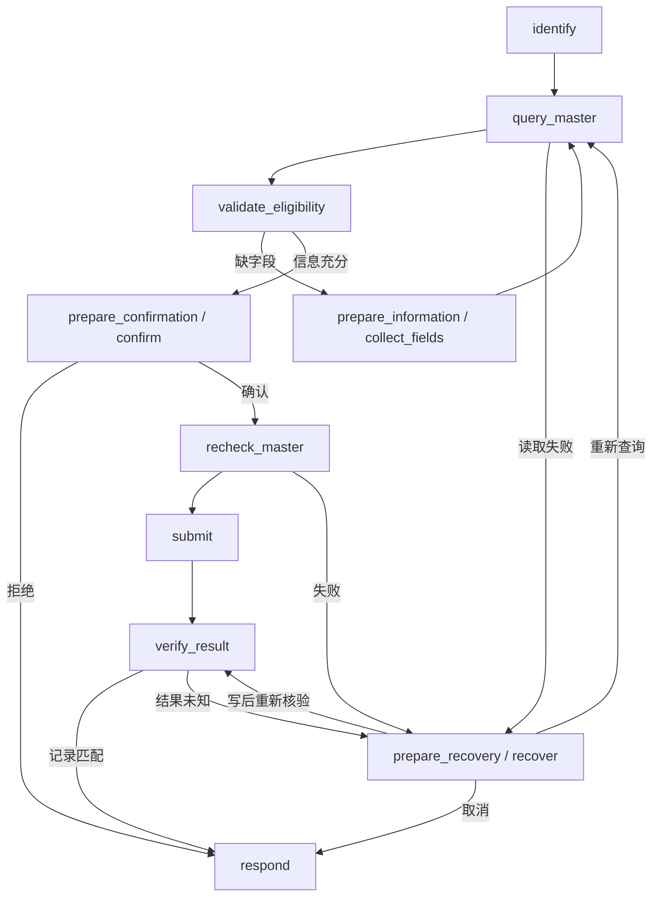
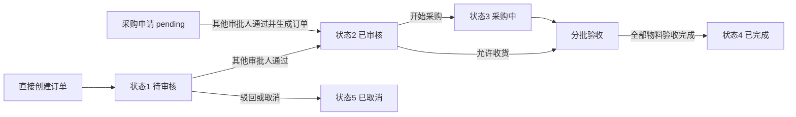

# 架构与源码解析

> 基于 2026-10-19 工作区源码。本文按“入口 → 编排 → 工具 → 业务事实 → 持久化 → 展示”说明系统，避免把历史注释当成现有能力。

## 1. 应用边界与运行单元

本项目覆盖供应商 / 物料、采购申请 / 订单、审批、收货和库存作业，以及辅助这些业务的智能助手。源码中出现基础客户 / 销售表，不代表已经实现完整销售、财务和生产 ERP。

| 单元 | 入口 | 责任 |
| --- | --- | --- |
| Vue 应用 | [AuthShell.vue](../frontend/src/AuthShell.vue)、[App.vue](../frontend/src/App.vue) | 登录后挂载工作台；本地 view 状态切换页面，无 Pinia / Vue Router |
| Web API | [web_main.py](../src/api_view/web_main.py) | 生命周期、认证、SSE、历史、附件与业务路由 |
| Agent 单例 | [agent_loader.py](../src/api_view/agent_loader.py) | 初始化和复用图、持久化资源关闭 |
| 主 Agent | [main_agent.py](../src/agent/main_agent.py) | 工具和专家装配、中间件、后端路由 |
| MCP Server | [server_main.py](../src/mcp_server/server_main.py) | 业务工具 schema、Streamable HTTP |
| ERP Backend | [app.py](../backend/app.py) | 业务规则、事务、共享认证与运营模块 |
| 持久化 | [postgres_persistence.py](../src/agent/postgres_persistence.py) | checkpoint、Store、展示消息生命周期 |

本地启动有 ERP、MCP、Web、Vue 四个进程，数据库自行准备；Docker 另编排 MySQL / PostgreSQL，前端用 Nginx 服务构建产物。

## 2. Agent 角色和工具权限

`create_main_agent` 使用 DeepAgents 构建图。两个 YAML 业务专家通过 `yaml.safe_load` 读取：

- [procurement_analyst.yaml](../src/agent/subagents/configs/procurement_analyst.yaml)：供应商 / 物料 / 库存 / 订单查询、实际收货汇总、图表和报告。
- [procurement_order.yaml](../src/agent/subagents/configs/procurement_order.yaml)：采购申请、订单、库存调整、主数据入口与补货建议。
- 另有显式 `general-purpose` 通用助手，也受权限中间件约束。系统不是只有三个固定 Agent 实例。

[loader.py](../src/agent/subagents/loader.py) 精确匹配工具；必需工具缺失、未知工具策略、重名冲突会阻止装配。`optional_tools` 才允许缺省。两个业务专家当前继承主模型，没有各自启用单独模型。

权限有三道实际控制：

1. [RoleToolPermissionsMiddleware](../src/agent/middlewares/tool_permissions.py) 在模型请求前隐藏当前角色不可用的工具，在执行前再次校验。
2. [request_scope.py](../src/agent/request_scope.py) 根据服务端保存的本轮用户请求限制写入范围；这是规则识别，不是完整语义意图证明。
3. [backend/auth.py](../backend/auth.py) 按 HTTP 方法与路径授权，查数据库中的当前角色和会话状态；未知 API 默认拒绝。

[auth_bridge.py](../src/agent/tools/auth_bridge.py) 将本次登录会话带到 MCP，[http_base.py](../src/mcp_server/http_base.py) 转发至 ERP 后端。模型提供的用户 ID、操作人或角色不能代替服务器身份。正式业务审批未作为 MCP 工具开放给模型。

## 3. 固定采购状态图

[tools/procurement.py](../src/agent/tools/procurement.py) 将模型可见的 `order_create` / `purchase_request_create` 替换为固定流程工具；原始 MCP 写工具及 `procurement_verification` 留给内部调用。

[procurement_workflow.py](../src/agent/procurement_workflow.py) 的图共有 13 个节点，按条件走不同分支：

关键约束：

- 草稿允许缺字段，程序生成请求 ID 和订单编号；字段补全来自结构化中断。
- 物料逐页查询，核对名称、完整编码、内部 ID 和供应商归属；歧义不能由模型猜 ID。
- 确认后再次检查主数据和准入条件，避免供应商合作状态已变化。
- 提交后只读核验单据的供应商、物料、数量、单价、日期等字段；匹配后才标记 `verified=True`。
- 写入结果未知时，恢复会重新核验，不直接重放写入；停止核验不能被描述为写入失败。
- 子图继承外层 checkpoint 和任务命名空间。一个流程处理一笔采购需求，订单可以含多行物料。

`order_update` 与 `inventory_adjust` 仍采用普通执行前 HITL，只支持 approve / reject；与创建流程的内部确认机制不同。

## 4. 正式业务状态与事务

### 两种采购入口

这不是全部状态边的枚举。实际允许的改单、取消和收货条件由后端判断：

- 创建订单不增加库存。正式审批使用订单快照版本，阻止审核期间内容变更；禁止自审。
- 采购申请通过后同事务生成状态 2 的订单；创建人保留申请人身份，相同审核重放不重复建单。
- 已审核订单不能随意改数量 / 价格；已有收货后的改单进一步受限。通用订单更新不能直接设为“已完成”。
- 只有验收合格数量入库。拒收数量记录在批次中，不增加库存；后续补货可继续验收。
- 收货事务同时更新库存和流水；送货单唯一约束、请求 ID 与请求指纹用于重复提交保护。
- 领料不能造成负库存，盘点需要检查账面量是否已变动，库存调整保存前后值与原因。

证据：[app.py](../backend/app.py)、[operations.py](../backend/operations.py)、[inventory.py](../backend/inventory.py)、[operations_schema.py](../backend/operations_schema.py)。

### 指标口径

补货建议为 `max(预警值 + 额外需求 - 当前库存 - 未到货订单量 - 待审批申请量, 0)`；支持明确的 manual 申请模式，因此不能写“所有申请都不能超过建议量”。库存看板的 shortage 只是阈值与库存差，不等于补货建议。订单金额按下单时间和非取消订单统计，不是付款金额。今日入库依据真实收货记录和北京时间自然日，不用订单创建 / 完成日期代替。

### 审计边界

库存作业的库存更新和业务流水在业务事务内。身份操作审计位于业务提交后的独立写入；审计失败可能返回“业务已保存但回执失败”的错误，应先核验。MySQL 与 PostgreSQL 没有跨库原子事务，不承诺分布式 exactly-once。

## 5. 中断、恢复与并发

主要 API：

| 方法 / 路径 | 作用 |
| --- | --- |
| `POST /api/chat/stream` | 发起当前账号的对话 |
| `POST /api/chat/{thread_id}/resume` | 用 `Command(resume=...)` 恢复 |
| `GET /api/chat/{thread_id}` | 查询状态和待处理中断 |
| `GET /api/history` | 当前用户会话列表 |
| `POST /api/chat/{thread_id}/tools/{tool_call_id}/retry` | 对可重试的只读工具复用原参数 |

[interrupts.py](../src/api_view/interrupts.py) 从 checkpoint 递归收集中断，按 ID 去重；类型包括 `hitl_approval`、`order_info_supplement`、`workflow_recovery`。恢复时验证 ID、决定数量、表单字段和当前权限，信任 checkpoint 中保存的操作，不信任客户端传回的工具名或 schema。

有待处理操作时新消息被拒绝。同一用户会话用进程内 `asyncio.Lock` 互斥；多进程 / 多副本仍需要外部协调。断线可尝试短时间保存部分历史，但不是自动完成恢复或无限自动重连。

## 6. 记忆、文件与技能

| 数据 | 存储 / 作用域 | 边界 |
| --- | --- | --- |
| 图状态与中断 | PostgreSQL checkpoint；`user-{id}:{public_thread_id}` | 内存降级重启丢失 |
| 用户偏好 | Store namespace `(user-{id},)` | 用户隔离，不是向量检索 |
| 持久技能 | Store namespace `(skills, user-{id})` | 运行时恢复到技能目录 |
| 网页消息 | `session_display_messages` JSONB | 保存失败阻止最终 answer/done |
| 工作文件 | `src/local_sandbox/users/{id}/` | FilesystemBackend，无任意 shell |
| 附件 | `src/download/web/users/{id}/` | 随机文件名并校验账号目录 |

[ContextInjectionMiddleware](../src/agent/middlewares/context_injection.py) 注入身份、北京时间业务日期、语言和偏好；[MemoryUpdateMiddleware](../src/agent/middlewares/memory_update.py) 可使用摘要模型维护最近供应商 / 查询摘要。它不是 RAG、知识图谱或向量记忆系统。

[SkillsSyncMiddleware](../src/agent/middlewares/skills_sync.py) 依据用户和文件哈希同步新增 / 修改，[UserSkillsRestoreMiddleware](../src/agent/middlewares/user_skills_restore.py) 恢复持久化技能。当前没有完整删除同步。仓库内爬虫脚本与旧 `assign_skill` 文件的存在，不代表当前 Agent 有执行脚本或自动安装技能的能力。

主图含权限、上下文、技能同步 / 恢复、摘要、记忆更新与调用上限中间件。摘要策略使用框架默认配置，本文不把旧注释中的 offload / 百分比阈值当作项目已锁定参数。

## 7. SSE、答案与结构化业务事实

[chat.py](../src/api_view/api/chat.py) 消费图的 `messages / values / custom` 子图事件，公开协议包括：

- 进度：`progress`、`procurement_progress`。
- 执行：`tool_start`、`tool_args`、`tool_result`、`tool_end`、`tool_error`。
- 答案：`answer_delta`、`answer`、`business_result`。
- 控制：`interrupt`、`done`、`error`。

`publish_business_answer` 提供明确的答案出口，可以引用本轮成功 task 的报告；普通模型前置叙述、内部记忆抽取不会直接全部进入最终正文。[business_results.py](../src/agent/business_results.py) 规范真实工具结果；[output_protocol.py](../src/api_view/output_protocol.py) 优先读取结构化工具 artifact，处理结果卸载后的展示。固定采购写入需核验成功才能确证成功。

[每日收货快速路径](../src/api_view/daily_receipts.py) 对明确的今日入库请求可直接读取业务记录并组织结果，减少不必要的模型推理。

## 8. 可选服务与已知限制

主模型 / 摘要模型默认 `deepseek-chat`，同用 OpenAI 兼容接口；没有自动供应商故障切换。ERP MCP 是启动依赖；搜索和外部图表 MCP 可禁用。本地 SVG 支持 bar、column、line、pie 四类，不能据第三方工具列表宣传默认内置更多图表。

模型 readiness 只检查配置；完整模型链路、真实浏览器、真实数据库和容器验证须分别进行。Python 依赖未完全锁定，单进程会话锁、身份审计独立提交、现有订单查询对当前主数据的依赖，均是需要说明的工程边界。
